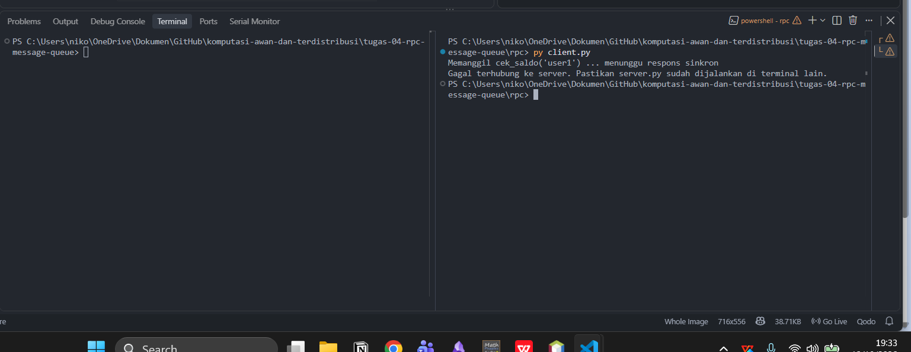

# Jurnal Proses — Tugas 4

## Diskusi Tanggal 12-Oktober-2026
Diksusi = Membahas Pembagian tugas untuk pengerjaan kelompok. Niko bagian pengerjaan kode, dan Liel bagian pengerjaan penjelasan di jurnal nya. 

## Diskusi Tanggal 13-Okttober-2026
Diskusi = Melakukan Testing pada kode dan mengambil bukti agar dapat membuat penjelasan di bagian jurnal.md

## Jalur yang dipilih
- [RPC], alasan: dikarenakan untuk bagian pembayaran memerlukan komunikasi secara sinkron, agar client mendapatkan respon pembayaran berhasil transaksi secara langsung dan instan.Serta system tersebut lebih simple dan juga tanpa perlu ada nya pihak ketiga yaitu broker.

## Penjelasan

Jadi Asrsitektur RPC adalah komunikasi antara client dan server bersifat sinkron (synchronous) dan tanpa perlu adanya perantara.

Kondisi Jika server mati di tengah proses :

- Pesan Request Langsung Hilang:
Dikarena RPC tidak mempunyai broker atau penampung pesan sementara, request dari client yang sedang berjalan akan langsung lenyap di jaringan. Pesan tersebut tidak disimpan di mana pun.

- Data State Server Reset (Hilang):
data saldo_user hanya disimpan di dalam memori/RAM dan bukan di database permanen, seluruh perubahan data akan hilang saat server mati. Saat dihidupkan lagi, saldo akan kembali ke angka awal (reset).

- Resiko Transaksi Menggantung :
Apabila server mati setelah mengurangi saldo tetapi sebelum mengirim respons ke client, client akan menganggap transaksi tersebut gagal dikarenakan menerima pesan error. Jika client mencoba melakukan pembayaran ulang, hal ini bisa menyebabkan saldo terpotong dua kali.
 
### Bukti
**1.Bukti Menjalankan Server **

**2. Bukti Menjalankan Client **

**3. Bukti Kondisi Server Mati

## Kendala teknis
- Error saat setup (mis. koneksi RabbitMQ ditolak, port bentrok): ...

## Uji "pesan tidak hilang" (khusus Jalur B)
- Langkah uji: matikan consumer → jalankan publisher → nyalakan consumer
- Hasil yang diamati: ...

## Log Penggunaan AI (Level 2)

> Wajib diisi sesuai kebijakan Level 2 di [`../RUBRIK-UMUM.md`](../RUBRIK-UMUM.md). Tulis "Tidak memakai AI" pada baris pertama jika memang tidak dipakai. Hanya untuk brainstorming ide/outline — bukan untuk kode/analisis/teks akhir.

| Tanggal | Tool AI | Prompt yang diberikan | Ringkasan saran/ide AI | Bagaimana diolah jadi tulisan/kode sendiri |
|---|---|---|---|---|
| ... | ... | ... | ... | ... |
| 13 Oktober 2026 | Gemini | Anda berperan sebagai sofware enginner disuatu perusahaan yang sedang menangani suatu projek memiliki banyak sistem lalu diminta menggunakan RPC sebagai sistem mitigasi, berikan kelebihan dan kekurangan dari RPC dan bandingkan dengan sistem yang lain | memberikan penjelasan dari RPC | digunakan untuk bagian penjelasan untuk kelompok kami mengetahui ciri ciri kelemahan dari RPC |
