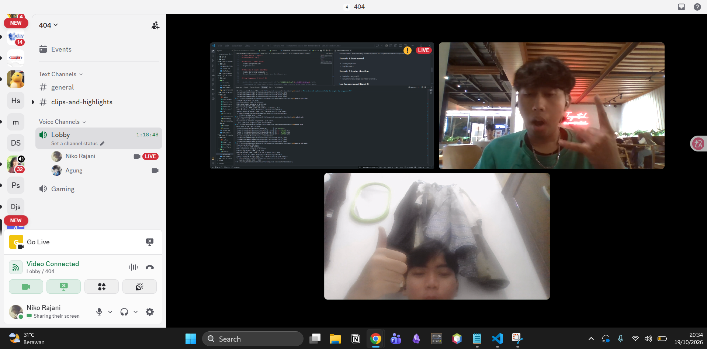
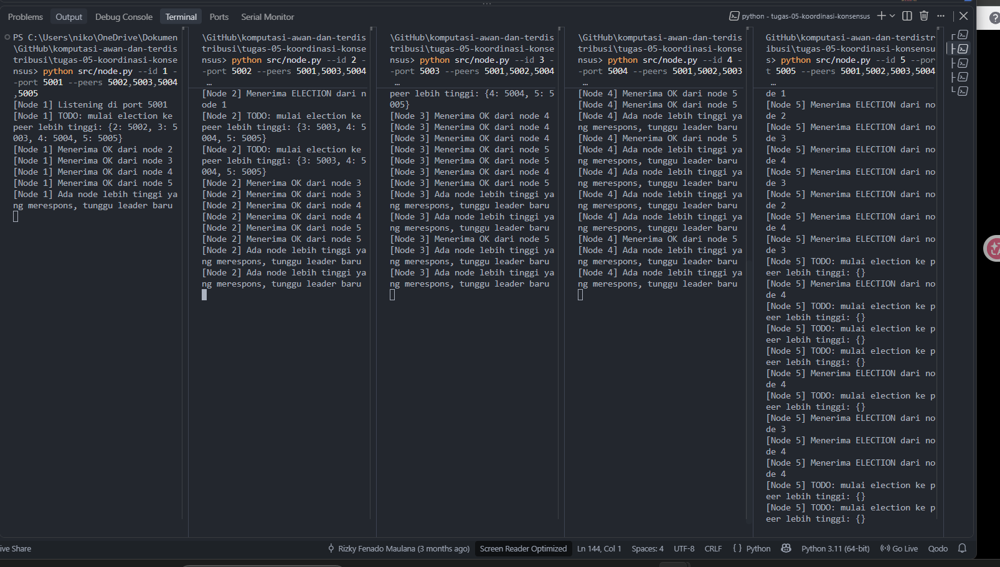

# Jurnal Proses — Tugas 5

## 19-Oktober-2026
Diskusi = membuat kode todo (niko mengerjakan todo 1 & 2 dan liel mengerjakan todo 3&4)
Bukti = 

## Implementasi Bully
- Kendala saat mengisi TODO 1-4: Terjadi deadlock (re-entrant lock) ketika start_election() memanggil declare_leader() secara langsung di dalam blok with self.lock:. Hal ini menyebabkan Node 5 terkuci dan tidak bisa dihentikan menggunakan Ctrl+C. Solusinya adalah memisahkan evaluasi kondisi ke dalam variabel lokal is_leader di dalam lock, lalu memanggil declare_leader() di luar blok lock, dengan begitu node 5 tidak terkunci dan akhir nya program berjalan.

Bukti ketika node saling terkunci:

Dalam kondisi itu, node tidak saling memilih siapa leader dan hanya memulai election tanpa henti. 

## Skenario 1: Start normal
- Leader yang terpilih: Node 5
- Log/observasi: ...
- alasan : kenapa dia bisa terpilih Node tersebut dikarenakan ada nya perbandingan mana id yang lebih tinggi di bagian func `start_election` dibagian `high_peers` disitu dia membandingkan bandingkan mana id yang tinggi. Lalu dia mengecek kembali setiap Nodenya dari 1 - 5 tergantung kita start duluan mana dulu. 

## Skenario 2: Leader dimatikan
- Leader baru yang terpilih: Node 4
- Berapa lama waktu sampai leader baru terdeteksi: kisaran 3 - 4 detik
- alasan : kenapa dia berpindah ke Node 4 disebabkan pada func start_election `high_peers`
kenapa bisa terjadi tersebut dikarenakan ada nya kondisi pada func `monitor_leader` disitu dia mengecek apakah leadernya masih hidup / engga dengan cara mengetest ping jika masih ada dia tetap jadi leader jika tidak system akan mengecek ulang siapa node tertinggi menurut id.

## Log Penggunaan AI (Level 2)

> Wajib diisi sesuai kebijakan Level 2 di [`../RUBRIK-UMUM.md`](../RUBRIK-UMUM.md). Tulis "Tidak memakai AI" pada baris pertama jika memang tidak dipakai. Hanya untuk brainstorming ide/outline — bukan untuk kode/analisis/teks akhir.

| Tanggal | Tool AI | Prompt yang diberikan | Ringkasan saran/ide AI | Bagaimana diolah jadi tulisan/kode sendiri |
|---|---|---|---|---|
| 19-Oktober-2026| claude | Jelaskan secara mendalam bagaimana bully algoritma bekerja, dari penjelasannya, berikan analogi dari cara kerja bully algoritma, termasuk psuedo code dari bully algoritma dan apa contoh penerapannya di dunia nyata | memberikan penjelasan lengkap dari bully algoritma | menggunakan penjelasan itu untuk menjawab todo di node py |
