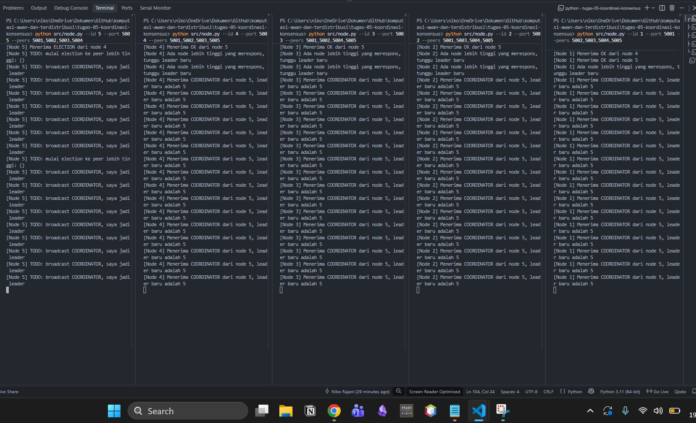
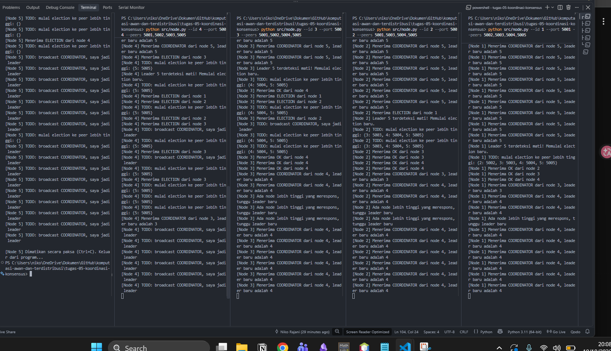

# Jurnal Proses — Tugas 5

## Implementasi Bully
- Kendala saat mengisi TODO 1-4: ...

## Skenario 1: Start normal
- Leader yang terpilih: Node 5
- Log/observasi: ...
- alasan : kenapa dia bisa terpilih Node tersebut dikarenakan ada nya perbandingan mana id yang lebih tinggi di bagian func `start_election` dibagian `high_peers` disitu dia membandingkan bandingkan mana id yang tinggi. Lalu dia mengecek kembali setiap Nodenya dari 1 - 5 tergantung kita start duluan mana dulu. 

## Skenario 2: Leader dimatikan
- Leader baru yang terpilih: Node 4
- Berapa lama waktu sampai leader baru terdeteksi: kisaran 3 - 4 detik
- alasan : kenapa dia berpindah ke Node 4 disebabkan pada func start_election `high_peers`
kenapa bisa terjadi tersebut dikarenakan ada nya kondisi pada func `monitor_leader` disitu dia mengecek apakah leadernya masih hidup / engga dengan cara mengetest ping jika masih ada dia tetap jadi leader jika tidak system akan mengecek ulang siapa node tertinggi menurut id.

## Log Penggunaan AI (Level 2)

> Wajib diisi sesuai kebijakan Level 2 di [`../RUBRIK-UMUM.md`](../RUBRIK-UMUM.md). Tulis "Tidak memakai AI" pada baris pertama jika memang tidak dipakai. Hanya untuk brainstorming ide/outline — bukan untuk kode/analisis/teks akhir.

| Tanggal | Tool AI | Prompt yang diberikan | Ringkasan saran/ide AI | Bagaimana diolah jadi tulisan/kode sendiri |
|---|---|---|---|---|
| ... | ... | ... | ... | ... |
