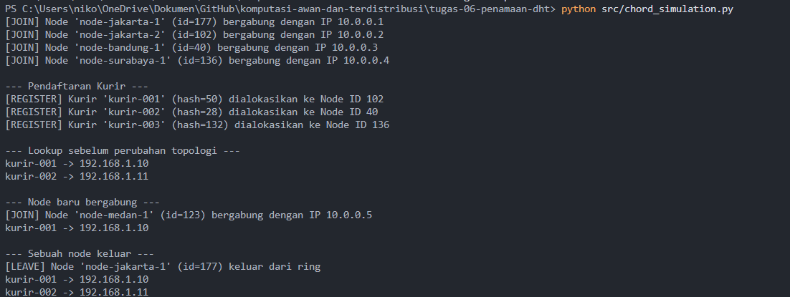

# Jurnal Proses — Tugas 6

## Pertemuan 27 Oktober 2026
Hasil Diskusi = Mengerjakan tugas masing masing, Liel Mengerjakan bagian Skenario join/leave dan Todo 1,2,3,4 dan Niko Mengerjakan bagian Implementasi find_successsor beserta todo 5 6 7. 


## Implementasi find_successor
- Kesalahan pertama yang ditemui: Lupa menangani kondisi *wrap-around* ketika `key_hash` lebih besar dari seluruh ID node di ring, serta belum ada validasi kondisi saat ring masih kosong.
- Cara memperbaikinya: Mengurutkan seluruh ID node aktif dengan `sorted(self.nodes.keys())`, lalu mengambil node pertama yang bernilai `>= key_hash`. Jika tidak ada node yang memenuhi, fungsi mengembalikan node pertama (`sorted_node_ids[0]`) sebagai bentuk *wrap-around* melingkar.
- Implementasi find_successor: ```find_successor``` adalah fungsi yang di gunakan sebagai mesin pencari rute didalam topologi chord (wrap around). Alur dari fungsi ini adalah sebagai berikut:
  1. Pengurutan
     Setiap kali pencarian di panggil, fungsi akan mengambil seluruh ID server (node) yang sedang aktif dan disusun dalam urutan membesar (ascending). Node yang masih dalam bentuk string (node-jakarta-1, node-bandung-1, node-jakarta-2 dst), akan di ubah lewat fungsi ``hash_id`` menjadi angka dengan rentang 0-255. Pada fase awal, node yang sudah di ubah ke bentuk hash akan berbentuk seperti [40, 102, 136, 177] dengan urutan membesar (ascending). 
  2. Pengkondisian (node_id >= key_hash)
     Algoritma akan melakukan pengecekan menggunakan kondisi: ``node_id >= key_hash``. Sistem akan melakukan pengecekan pada deret angka node tersebut [40, 102, 136, 177], lalu sistem akan berhenti pada entitas pertama yang nilainya lebih besar atau sama dengan nilai hash pencarian (node_id >= key_hash). 
  3. Pengecekan (untuk Wrap Around mekansime)
     Jika ternyata nilai key_hash nya melampaui ID server tertinggi di dalam deretan angka itu (misal 200, sementara batas atas nya adalah 177), maka siklus pemindaian nya akan gagal dan fungsi akan secara otomatis kembali secara melingkar dengan menunjuk index pertama dari deret tersebut (sorted_nodes_ids[0]), dengan begitu tercipta cincin yang di sebut mekanisme Wrap around. 

## Skenario join/leave
- Hasil sebelum & sesudah node baru bergabung:

- sebelum : kita telah mendaftarkan kurir contohnya (kurir-001, kurir-002, kurir-003) dan nama tersebut kita hash, setelah kita hash, kita mencari mana id hash yang terdekat dengan mengikuti kondisi (ID node => key_hash).

- Sesudah `node-medan-1` masuk ke dalam *ring*, sistem akan meng-hash nama tersebut menjadi sebuah ID. Jika posisi ID node baru ini berada lebih dekat dengan ID kurir dan menggantikan posisi node penanggung jawab sebelumnya, maka `node-medan-1` akan otomatis mengambil alih kepemilikan data kurir tersebut. Informasi IP kurir akan ikut dipindahkan dan disimpan dengan aman oleh node baru untuk memastikan tidak ada data yang hilang dari sistem selama masa transisi.

- Hasil sebelum & sesudah node baru bergabung:...
- Hasil sebelum & sesudah node keluar: ...

- Sebelum: `node-jakarta-1` tidak menyimpan data kurir apa pun karena ID hash-nya bukan merupakan node terdekat (successor) bagi ID kurir mana pun yang sudah terdaftar di dalam sistem.

- Sesudah: Saat fungsi `leave("node-jakarta-1")` dijalankan, sistem memeriksa apakah ada data pada node tersebut yang perlu dialihkan. Karena node-jakarta-1 tidak memegang data kurir apa pun, node tersebut langsung keluar dari ring tanpa perlu memindahkan data ke node lain.

## Bukti Output Terminal



## Log Penggunaan AI (Level 2)

> Wajib diisi sesuai kebijakan Level 2 di [`../RUBRIK-UMUM.md`](../RUBRIK-UMUM.md). Tulis "Tidak memakai AI" pada baris pertama jika memang tidak dipakai. Hanya untuk brainstorming ide/outline — bukan untuk kode/analisis/teks akhir.

| Tanggal | Tool AI | Prompt yang diberikan | Ringkasan saran/ide AI | Bagaimana diolah jadi tulisan/kode sendiri |
|---|---|---|---|---|
|25-10-2026| Gemini | Jelaskan konsep Distributed Hash Table (DHT) dan algoritma Chord dalam studi kasus penamaan IP dinamis kurir FoodGo, kenapa DNS/flat naming tidak cocok, serta cara kerja fungsi lookup, join, dan leave | Menjelaskan analogi ring topology (m=8 bit), aturan successor (N >= k), serta alasan DNS konvensional gagal menangani IP dinamis akibat keterbatasan cache TTL. | Menggunakan konsep ring topology dan aturan successor tersebut sebagai kerangka analisis untuk README.md dan dasar logika alur fungsi find_successor() pada kode chord_simulation.py. |
